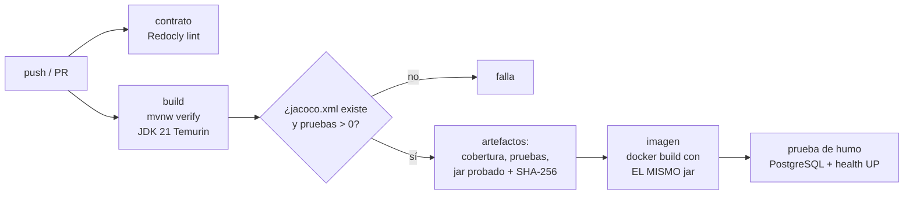
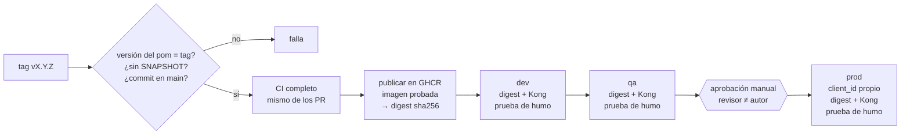

# transferencia-api — Banco Izalco Digital

API para que la app móvil de Banco Izalco Digital registre y consulte transferencias
interbancarias, integrándose con el core bancario legado (XML).

> **Post-mortem del incidente INC-2026-118:** [`docs/postmortem-INC-2026-118.md`](docs/postmortem-INC-2026-118.md)
> (configuración [original](docs/incidente/config-prod.original.yaml) y [corregida](docs/incidente/config-prod.corregido.yaml)).
> Documento en construcción: la revisión final se agrega en la siguiente fase.

## Contrato de la API

El contrato es **contract-first** en OpenAPI 3.1:
[`src/main/resources/openapi/transferencias.yaml`](src/main/resources/openapi/transferencias.yaml).

| Método | Ruta | Descripción |
|---|---|---|
| `POST` | `/transferencias` | Registra una transferencia (requiere `X-Idempotency-Key`). |
| `GET` | `/transferencias/{id}` | Consulta una transferencia en cualquier estado. |

Validar el contrato:

```powershell
npx --yes @redocly/cli@2.64.1 lint
```

## Ejecutar en local

Requisitos: Docker Desktop y JDK 21.

```powershell
.\mvnw.cmd clean verify          # pruebas + gate de cobertura (usa Testcontainers: Docker encendido)
docker compose up --build -d     # PostgreSQL + core simulado (WireMock) + API en http://localhost:8080
.\scripts\probar-local.ps1       # recorre todos los escenarios del core
docker compose down -v           # apaga todo y borra los datos
```

El core simulado ([`wiremock/mappings`](wiremock/mappings)) decide la respuesta según la **cuenta origen**:

| Cuenta origen | Respuesta del core | Respuesta de la API |
|---|---|---|
| cualquier otra (p. ej. `100200300`) | `00` aprobada | `201` `APROBADA` |
| `510000000` | `51` saldo insuficiente | `422` `SALDO_INSUFICIENTE` |
| `620000000` | `62` cuenta bloqueada | `422` `CUENTA_BLOQUEADA` |
| `910000000` | `91` no disponible | `503` `CORE_NO_DISPONIBLE` |
| `990000001` | tarda 20 s (más que el timeout de lectura de 15 s) | `504` `CORE_TIMEOUT` |
| `990000002` | código `77` no documentado | `502` `RESPUESTA_CORE_INVALIDA` |
| `990000003` | cuerpo que no es XML | `502` `RESPUESTA_CORE_INVALIDA` |

Las credenciales de `docker-compose.yml` son falsas y solo sirven en local; los puertos se publican en
`127.0.0.1`. Si las credenciales del core no coinciden, el simulador responde `401` (la API lo traduce a `502`).

## Integración continua

[`.github/workflows/ci.yml`](.github/workflows/ci.yml) corre en cada push a `main` y en cada pull request:



| Job | Qué hace | Falla si… |
|---|---|---|
| `contrato` | `redocly lint` del contrato OpenAPI | el contrato tiene errores o advertencias |
| `build` | `mvnw verify`: pruebas (Testcontainers) + gate JaCoCo ≥ 80 % de líneas | una prueba falla o la cobertura baja de 80 % |
| | [`verificar-evidencia.sh`](scripts/ci/verificar-evidencia.sh) | no existe `jacoco.xml` o se ejecutaron 0 pruebas (p. ej. con `-DskipTests`) |
| | Publica `reporte-cobertura`, `reporte-pruebas` y `jar-probado` (jar + SHA-256) | — |
| `imagen` | Descarga `jar-probado`, verifica el SHA-256 y construye la imagen **sin recompilar** | el jar no es el que pasó `verify` |
| | [`smoke-imagen.sh`](scripts/ci/smoke-imagen.sh): arranca la imagen con PostgreSQL | no corre como UID 10001 o `/actuator/health` no responde `UP` |
| `resultado` (*CI completo*) | Revisa el resultado de todos los jobs anteriores (`if: always()`) | algún job no terminó en `success`: un job *skipped* o *cancelled* cuenta como fallo |

**Por qué existe `CI completo`.** GitHub cuenta un job *skipped* como exitoso, aunque sea un check obligatorio del
ruleset. Si `build` falla, `imagen` se salta y su check queda en verde. `CI completo` convierte cualquier resultado
distinto de `success` en un fallo, así que ningún job saltado puede dejar pasar un PR.

**Build once.** El jar que pasa `verify` es el que entra en la imagen: el job `imagen` lo pasa al Dockerfile
con `--build-context jar=artefacto`, que reemplaza la etapa `jar` del Dockerfile, así que la etapa de
compilación no se ejecuta. El build vuelve a comprobar el SHA-256 (`JAR_SHA256`) y lo deja como etiqueta
`com.izalco.jar.sha256` en la imagen, junto con el commit (`org.opencontainers.image.revision`).

**Seguridad del workflow.**
- Actions fijadas por **SHA completo** del commit (con la versión en un comentario).
- `permissions: contents: read`.
- `checkout` con `persist-credentials: false`.
- Runner `ubuntu-24.04` fijo.

### Protección de `main`

La protección de ramas exige un repositorio público en el plan gratuito. Configuración (ruleset):

1. *Settings → Rules → Rulesets → New ruleset → New branch ruleset*.
2. Nombre `proteger-main`, *Enforcement status*: **Active**, *Bypass list*: **vacía**.
3. *Target branches → Add target → Include default branch*.
4. Reglas:
   - **Restrict deletions** y **Block force pushes**.
   - **Require a pull request before merging**, con *Required approvals*: **0** (equipo de una persona; la
     regla "quien aprueba no es el autor" se aplica donde importa: el environment `prod`).
   - **Require status checks to pass**, con *Require branches to be up to date before merging*. Agregar los checks:
     - `Lint del contrato OpenAPI`
     - `Configuración de ambientes (Kustomize y Kong)`
     - `Build, pruebas y cobertura`
     - `Imagen Docker con el jar probado`
     - `CI completo` (falla si cualquiera de los anteriores se saltó o se canceló)

Con esto nadie puede llevar a `main` un cambio que no haya pasado el CI, ni siquiera el administrador. La bypass list está vacía.

## Release y despliegue (CD)

[`.github/workflows/cd.yml`](.github/workflows/cd.yml) se dispara **solo** al crear un tag `vX.Y.Z`:



| Control | Cómo |
|---|---|
| Sin SNAPSHOT, versión coherente | El job `validar-version` falla si el `pom` es SNAPSHOT o no coincide con el tag |
| Solo código revisado | El commit del tag debe pertenecer a `main` (que exige PR + CI) |
| Mismo artefacto | La imagen que pasó el CI se publica **sin reconstruir** y se despliega por **digest** en los tres ambientes |
| Identidad de servicio | `GITHUB_TOKEN` efímero; `packages: write` solo en `publicar`; el resto, solo lectura |
| Aprobación antes de prod | Environment `prod` con *required reviewers* y *prevent self-review* |
| Ninguna rama se salta la aprobación | Environment `prod` acepta solo tags `v*.*.*`; las ramas (incluida `hotfix/*`) no pueden desplegar |
| Ventana de cambio | [`ventana-de-cambio.sh`](scripts/cd/ventana-de-cambio.sh): prod solo de lunes a jueves, por defecto 08:00–15:59 (UTC-6), evaluado **después** de la aprobación; horas en variables del repositorio, límites fijos en el código; sus casos se prueban en cada PR. Emergencias: [proceso de cambio de emergencia](#cambio-de-emergencia-fuera-de-la-ventana) |
| Credenciales por ambiente | Secreto `CLIENT_ID_APP_MOVIL` en cada environment; prod falla si su huella coincide con la de dev o qa |
| Políticas de API como código | `gateway/kong-<ambiente>.yaml`: `key-auth` (header `client_id`) y `rate-limiting` 30 / 60 / 120 por minuto |

**Destino del despliegue.** No hay un clúster persistente gratuito, así que cada job levanta el ambiente de forma
efímera en el runner ([`deploy/docker-compose.yml`](deploy/docker-compose.yml)): la imagen **por digest**, Kong DB-less
con su política, PostgreSQL y el core simulado. Después, [`smoke-ambiente.sh`](scripts/cd/smoke-ambiente.sh) comprueba:
- `/actuator/health` UP con el perfil del ambiente;
- `401` sin `client_id` o con uno inválido;
- `201` de punta a punta con el `client_id` del ambiente;
- `429` con `Retry-After` al superar el límite.

En un ambiente real, el mismo job aplicaría [`k8s/overlays/<ambiente>`](k8s/) en un clúster persistente
autenticándose por **OIDC**, sin secretos de larga duración.

### Kubernetes (Kustomize)

[`k8s/base`](k8s/base) incluye:
- **API:** pods no root (UID 10001), sistema de archivos de solo lectura, sin capacidades, sondas `startup`/`liveness`/`readiness`, `maxUnavailable: 0` y sin token de la API de Kubernetes.
- **Kong DB-less**, con su configuración montada desde un `Secret`.

Cada overlay ([`dev`](k8s/overlays/dev), [`qa`](k8s/overlays/qa), [`prod`](k8s/overlays/prod)) fija:
- su namespace, con *Pod Security* `restricted`;
- su `ConfigMap`, con perfil, URLs, timeouts y pool;
- réplicas y recursos.

`prod` tiene **2 réplicas** de API y Kong, reparto entre nodos y `PodDisruptionBudget`.

La imagen se fija por digest al desplegar:
```bash
kustomize edit set image ghcr.io/jonathanava/transferencia-api=ghcr.io/jonathanava/transferencia-api@sha256:<digest>
```
El job `config-ambientes` del CI valida todo con `kustomize build` + `kubeconform -strict` y reglas propias
([`validar-config-ambientes.sh`](scripts/ci/validar-config-ambientes.sh)):
- prod con 2 o más réplicas y PDB;
- ningún ambiente con URLs de otro;
- namespaces, consumidores y etiquetas propios;
- Kong válido (`kong config parse`), sin llaves escritas y con límites distintos.

### Configurar los environments en GitHub

Requiere repositorio **público** en el plan gratuito. Los revisores obligatorios de un environment solo están
disponibles en repositorios públicos o en planes pagos.

1. **Secretos de cada ambiente.** *Settings → Environments → New environment*. Crear `dev`, `qa` y `prod`. En cada uno,
   *Environment secrets → Add environment secret*: `CLIENT_ID_APP_MOVIL` con un valor **distinto** por ambiente.
   Para generar uno: `[guid]::NewGuid().ToString("N")` en PowerShell.
2. **`dev` y `qa`.** *Deployment branches and tags → Selected branches and tags → Add deployment branch or tag rule*:
   tipo **Tag**, patrón `v*.*.*`.
3. **`prod`:**
   - **Required reviewers**: activar y agregar al menos un revisor que **no** sea quien crea los tags. Hace falta
     una segunda cuenta de GitHub con acceso al repositorio (*Settings → Collaborators*).
   - **Prevent self-review**: activar. Quien disparó el despliegue (quien hizo push del tag) no puede aprobarlo.
   - **Allow administrators to bypass configured protection rules**: **desactivar**.
   - *Deployment branches and tags*: **Selected branches and tags**, solo la regla de tipo **Tag** `v*.*.*`. Así
     ninguna rama (`main`, `hotfix/*`…) puede desplegar en prod.
4. *(Opcional)* **Wait timer** en `prod` (p. ej. 5 minutos) para tener un margen de cancelación.
5. **Horario de la ventana de cambio** *(opcional; sin ellas: 08:00–15:59)*. *Settings → Secrets and variables → Actions →
   Variables → New repository variable*: `VENTANA_PROD_HORA_INICIO` (p. ej. `8`) y `VENTANA_PROD_HORA_FIN` (p. ej. `16`,
   hora no incluida). Cada run de CD deja en su resumen la ventana que aplicó.
   - Una variable se cambia sin PR. Por eso los **límites** están en el script y solo cambian con un PR revisado: solo
     de lunes a jueves, inicio desde las 06:00, fin hasta las 18:00. Si las variables piden algo fuera de eso, el
     despliegue falla.

### Cambio de emergencia fuera de la ventana

El pipeline **no** tiene un botón de *bypass*: una excepción automática es justo lo que permitió
`Approval step: skipped (branch = hotfix/*)` en el incidente INC-2026-118. Una emergencia sigue un **control organizativo**:

1. **Aprobación del responsable de cambios**, por escrito, antes de tocar nada.
2. **Motivo registrado** en un issue `Cambio de emergencia`: impacto de no actuar, riesgo, plan de reversión y quién
   aprueba en prod.
3. **PR enlazado al issue** que amplía la ventana en el script. Pasa por el CI y la revisión normales. Después se crea
   el tag y prod sigue exigiendo un revisor distinto del autor. Solo cambia la ventana; ningún otro control se apaga.
4. **Revisión posterior** en un máximo de 2 días hábiles: ¿era una emergencia?, ¿qué falló?, y un PR que **restaura** la
   ventana.

### Publicar una versión

```powershell
# 1. En una rama: subir la versión del pom (sin SNAPSHOT), PR y merge a main con el CI en verde.
.\mvnw.cmd versions:set -DnewVersion=1.0.1 -DgenerateBackupPoms=false
# 2. Desde main actualizado: crear y subir el tag.
git switch main; git pull
git tag -a v1.0.1 -m "Release 1.0.1"
git push origin v1.0.1
# 3. Actions → CD: dev y qa se despliegan solos; prod espera la aprobación del revisor.
```

## Configuración por ambiente

Un solo artefacto para todos los ambientes; lo que cambia se elige con `SPRING_PROFILES_ACTIVE`
(`dev`, `qa` o `prod`) y **las URLs y credenciales llegan solo por variables de entorno** (en Kubernetes,
desde un `Secret`). Ningún archivo de configuración contiene URLs ni contraseñas, y una prueba lo verifica.

| Variable | Obligatoria | Descripción |
|---|---|---|
| `SPRING_PROFILES_ACTIVE` | sí | `dev`, `qa` o `prod` (solo uno) |
| `DB_URL`, `DB_USUARIO`, `DB_PASSWORD` | sí | Conexión a PostgreSQL |
| `CORE_URL`, `CORE_USUARIO`, `CORE_PASSWORD` | sí | Endpoint y usuario de servicio del core |
| `CORE_TIMEOUT_CONEXION` | no (2 s) | Timeout para conectar con el core |
| `CORE_TIMEOUT_LECTURA` | no (15 s) | Timeout para recibir la respuesta; debe superar el p95 real del core |
| `IDEMPOTENCIA_EXPIRACION` | no (24 h) | Tiempo durante el cual se recuerda una llave |
| `DB_POOL_MAXIMO` | no (5 / 10 / 20) | Conexiones del pool por réplica (dev / qa / prod) |

**Fail fast:** si falta una variable obligatoria, la aplicación no arranca.
**Guardia de prod:** con el perfil `prod`, la aplicación no arranca si `CORE_URL` o `DB_URL` contienen
`dev`, `qa`, `test`, `uat`, `staging`… (palabra completa), ni si hay dos perfiles de ambiente activos.
Corre antes de crear cualquier bean, así que Flyway nunca llega a conectarse a la base equivocada.

| | dev | qa | prod |
|---|---|---|---|
| Logs | texto, `DEBUG` para `com.izalco` | JSON (ECS), `INFO` | JSON (ECS), `INFO` |
| Pool de conexiones | 5 | 10 | 20 |

Todos los logs llevan el `correlationId` y los números de cuenta enmascarados (`*****0300`); el concepto no
se registra. Actuator expone solo `/actuator/health` (con `liveness` y `readiness`) e `/actuator/info`
(ambiente y versión del artefacto).

## Cadena de timeouts

Cada eslabón debe esperar **más** que el siguiente. Si no, alguien se rinde mientras el de atrás
todavía está trabajando, y un reintento puede duplicar la transferencia.

```
app móvil (30 s)  >  gateway Kong (20 s)  >  API → core, lectura (15 s)  >  p95 del core (medido)
```

| Eslabón | Valor de referencia | Configuración |
|---|---|---|
| App móvil | 30 s | Cliente HTTP de la app |
| Gateway (Kong) | 20 s | `read_timeout` del servicio en Kong (Fase 7) |
| API → core (lectura) | 15 s | `CORE_TIMEOUT_LECTURA` |
| API → core (conexión) | 2 s | `CORE_TIMEOUT_CONEXION` (debe ser menor que la lectura) |
| Core | p95 medido por ambiente | Monitoreo; en el incidente el p95 fue 9.8 s con timeout de 5 s |
| Llave atrapada | lectura + 30 s = 45 s | `IDEMPOTENCIA_MARGEN_EN_PROCESO` |

**¿Qué pasa si alguien se rinde antes?**

- **La app se rinde antes que la API** (por ejemplo, su timeout es menor) y reintenta con la **misma**
  llave mientras la primera solicitud sigue esperando al core → `409 SOLICITUD_EN_PROCESO`. No se llama otra
  vez al core ni se duplica nada. La app reintenta en unos segundos y, cuando la primera termina, recibe la
  respuesta guardada (`Idempotent-Replayed: true`).
- **El gateway se rinde antes que la API** → la app recibe un 504 de Kong, pero la API sigue y guarda el
  resultado; el reintento con la misma llave recibe 409 o la respuesta guardada.
- **La API se rinde ante el core** (timeout de lectura) → `504 CORE_TIMEOUT`, transferencia
  `PENDIENTE_CONFIRMACION`, llave cerrada: los reintentos reciben siempre ese 504 guardado.
- **El pod de la API muere a mitad de la llamada** → la llave queda `EN_PROCESO`. Pasado
  *timeout de lectura + margen*, el siguiente reintento la cierra como incierta (`504`,
  `PENDIENTE_CONFIRMACION`). Nunca se libera, porque el core pudo haber recibido la transferencia.

La regla para la app: **un reintento siempre usa la misma `X-Idempotency-Key`**. Una llave nueva solo
para una transferencia nueva.

## Supuestos

Decisiones tomadas donde el enunciado no define el comportamiento:

1. **Formato de `X-Idempotency-Key`:** UUID generado por la app, uno por intento lógico de transferencia.
2. **Validaciones de entrada:** cuentas de 6 a 20 dígitos y distintas entre sí; `bancoDestino` con
   formato `AAA-9999` (según el ejemplo `BIZ-0042`); `concepto` de 1 a 140 caracteres; monto mayor que 0,
   máximo 2 decimales significativos y 13 dígitos enteros (ver supuesto 16); `fechaSolicitud` debe incluir zona horaria.
3. **Glosa del core:** si el concepto supera 30 caracteres se **trunca** (no se rechaza), se pasa a
   mayúsculas y se eliminan tildes y caracteres no ASCII.
4. **Respuesta del core:** no está definida en el enunciado; se asume
   `<TransferenciaResponse><Codigo/><Referencia/><Mensaje/></TransferenciaResponse>`.
5. **Rechazos de negocio (51, 62):** se guardan con estado `RECHAZADA` y se devuelven como `422`
   con el `transferenciaId` para poder consultarlos.
6. **Resultado incierto (timeout o código desconocido del core):** se guarda como
   `PENDIENTE_CONFIRMACION`, no se reintenta contra el core y la respuesta queda guardada para
   *replay*. En producción se necesita un proceso de conciliación (fuera del alcance).
7. **Core no disponible (91 o conexión rechazada):** la transferencia no se procesó con certeza,
   así que **no** se guarda y la llave de idempotencia se libera para que la app pueda reintentar
   con la misma llave.
8. **Errores:** Problem Details (RFC 9457) usando el campo estándar `detail` para el texto
   legible, más las extensiones `codigo` y `correlationId`.
9. **Client ID y rate limiting:** los aplica el API Gateway (Kong); los errores `401` y `429` tienen
   el formato propio de Kong.
10. **Dos timeouts distintos hacia el core:**
    - *Conexión* (`CORE_TIMEOUT_CONEXION`, por defecto 2 s): si vence, o si la conexión es rechazada,
      la solicitud nunca llegó al core → `503 CORE_NO_DISPONIBLE` y la llave se libera.
    - *Lectura* (`CORE_TIMEOUT_LECTURA`, por defecto 15 s): si vence, el core recibió la solicitud y
      pudo procesarla → `504 CORE_TIMEOUT`, `PENDIENTE_CONFIRMACION` y la llave **no** se libera.
    - El de lectura debe ajustarse al p95 real del core de cada ambiente (en el incidente el p95 fue
      9.8 s contra un timeout de 5 s). La aplicación no arranca si el de conexión no es menor que el de lectura.
11. **Otras fallas con resultado incierto:** conexión cortada a mitad de la respuesta, status HTTP
    distinto de 2xx, cuerpo vacío o XML inválido → `502 RESPUESTA_CORE_INVALIDA` y `PENDIENTE_CONFIRMACION`.
    Ante la duda, se asume que el core pudo procesar la transferencia (nunca se arriesga un duplicado).
12. **Sin reintentos automáticos hacia el core:** el core no es idempotente.
13. **Autenticación con el core:** HTTP Basic con un usuario de servicio (`CORE_USUARIO` / `CORE_PASSWORD`),
    sobre HTTP/1.1 y sin seguir redirecciones.
14. **Glosa vacía:** si el concepto queda vacío tras quitar caracteres no ASCII (por ejemplo, solo
    emojis), se envía la glosa `TRANSFERENCIA`.
15. **Monto hacia el core:** siempre con 2 decimales (`100` → `100.00`).
16. **Decimales del monto:** se cuentan los decimales **significativos** (sin ceros a la derecha), porque
    en JSON `150.750` y `150.75` son el mismo número: `150.750` se acepta y se guarda como `150.75`;
    `150.755` se rechaza con 400. El contrato, la validación (`@MontoValido`) y las pruebas aplican la misma regla.
17. **Huella de la solicitud (idempotencia):** SHA-256 del *contenido* interpretado, no del texto JSON. El
    orden de los campos, los espacios o el offset de la fecha (si es el mismo instante) no la cambian.
18. **Llave atrapada:** una llave `EN_PROCESO` por más de *timeout de lectura + margen* (por defecto
    15 s + 30 s) se cierra como resultado incierto (`504 CORE_TIMEOUT`, `PENDIENTE_CONFIRMACION`). Nunca se
    libera automáticamente ni se vuelve a llamar al core.
19. **Error inesperado tras reservar la llave:** se responde 500 y la llave queda `EN_PROCESO`; pasado el
    umbral se cierra como incierta (conservador: nunca se libera algo que pudo llegar al core).
20. **Llaves vencidas:** pasadas 24 h (`IDEMPOTENCIA_EXPIRACION`) la llave se borra al reutilizarse y se
    trata como nueva. Una purga periódica de llaves vencidas queda fuera del alcance.
21. **Errores de Spring no listados en el contrato** (ruta inexistente, 405, 415): Problem Details con
    `codigo` `SOLICITUD_INVALIDA` y su status real.
22. **`Location`:** ruta relativa (`/transferencias/{id}`), válida según RFC 9110 y correcta detrás del gateway.
23. **Perfil sin ambiente:** sin `SPRING_PROFILES_ACTIVE` la aplicación arranca con la configuración común
    (útil en local). Los manifiestos de cada ambiente siempre fijan el perfil.
24. **Guardia de prod por palabras completas:** se busca `qa`, `dev`, etc. como palabra separada en la URL, no
    como subcadena, para no rechazar hosts legítimos como `devoluciones.izalco.com`. No reemplaza la
    validación de configuración del pipeline (Fase 7); es la última barrera dentro de la aplicación.
25. **Datos que se registran en logs:** id, estado, cuentas enmascaradas (últimos 4 dígitos), banco, monto
    y referencia del core. No se registra el concepto (texto libre, puede contener datos personales).
26. **Imagen:** `eclipse-temurin` con versión fija (`21.0.13_9-jre-noble`), usuario UID 10001. Las pruebas no
    corren dentro de `docker build` (necesitan Docker); el pipeline ejecuta `verify` antes de construirla.
27. **Un solo Dockerfile para local y pipeline:** en local compila solo (cómodo); en el pipeline recibe el jar
    probado con `--build-context`. Se descartó un segundo Dockerfile "solo CI" porque dos archivos que
    deben producir la misma imagen terminan divergiendo.
28. **El CI no publica la imagen:** la construye y la prueba en cada push/PR, pero solo el workflow de
    release (Fase 7, al crear un tag `vX.Y.Z`) la publica en GHCR. Así el registro solo contiene versiones
    de release, nunca imágenes de ramas.
29. **Pruebas mínimas:** el paso de evidencia exige más de 0 pruebas, no un número fijo. Un mínimo fijo
    obligaría a cambiar el workflow cada vez que se agregan pruebas; borrar pruebas en masa ya lo detecta
    el gate de cobertura.
30. **Llave de Kong como plantilla:** Kong OSS 3.9 no resuelve referencias `{vault://env/...}` en las credenciales
    de `key-auth`; se verificó que guarda el texto literal. La llave se inyecta con `envsubst` desde el secreto del
    environment en el momento del despliegue, y el CI falla si alguien escribe una llave literal en el archivo.
31. **Rate limiting `policy: local`:** el contador vive en cada nodo de Kong. Con 2 réplicas, el límite efectivo
    puede llegar al doble. En producción se usaría `policy: redis` para un contador compartido.
32. **Kong 3.9.1:** es la última versión de Kong Gateway publicada como imagen OSS. Las siguientes requieren licencia
    Enterprise o Konnect.
33. **Ambientes efímeros:** el despliegue a dev/qa/prod levanta el ambiente en el runner y lo destruye al terminar.
    Demuestra la promoción por digest, las políticas y la aprobación; no deja un servicio corriendo.
34. **Versión del pom:** `main` queda en la última versión liberada (`1.0.0`) y la siguiente se fija en el PR que la
    prepara. Se descartó `-SNAPSHOT` en `main` porque obligaría a un commit extra en cada release.
35. **Ventana de cambio de prod:** lunes a jueves, por defecto de 08:00 a 15:59, hora de El Salvador (UTC-6 todo el año).
    Así siempre queda un día hábil después del despliegue. Las horas se ajustan con variables del repositorio, dentro de
    límites fijos en el código (06:00–18:00, nunca viernes ni fin de semana). No hay excepción por rama ni por usuario:
    las emergencias siguen el [proceso de cambio de emergencia](#cambio-de-emergencia-fuera-de-la-ventana). Los feriados
    quedan fuera del alcance.
36. **Hora del incidente:** el anexo indica que a las 4:55 p.m. la app móvil **reporta** el problema. Como los 504 empiezan
    a las 4:40, se asume que el despliegue fue antes de las 4:40 (el log del pipeline no trae hora).
